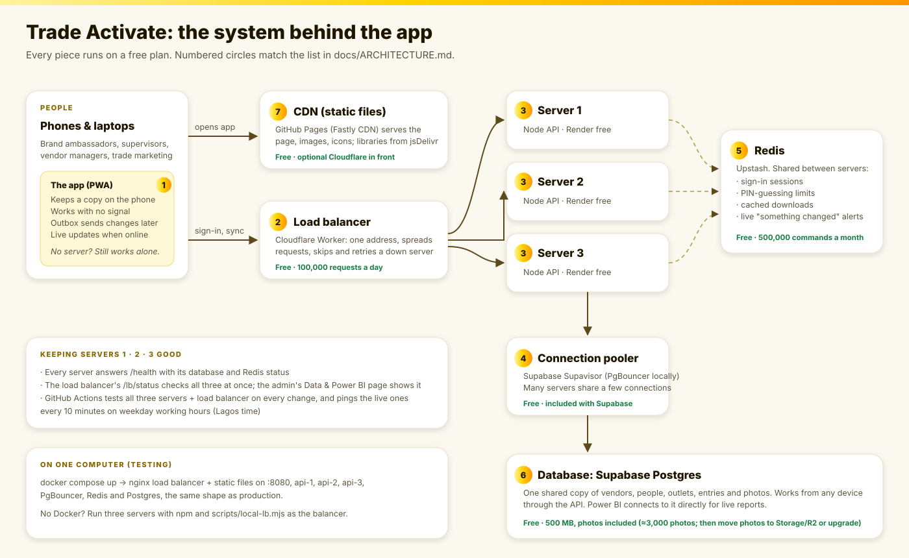

# How Trade Activate runs: front end, load balancer, servers, pooler, Redis, database, CDN



Trade Activate started as a page that kept everything on each phone. This adds a real backend so every
phone and laptop shares one copy of the data, **without breaking the old behaviour**: if no server is set,
or a phone has no signal, the app keeps working on its own copy and syncs when it can.

Everything below runs on **free plans**. Nothing here is switched on until you create the accounts and
paste the addresses (see "Switching it on").

## The seven pieces, in plain words

| # | Piece | What it does for us | What we use (free) |
|---|---|---|---|
| 1 | **Front end** | The app people tap on. It saves to the phone first, then sends changes through an "outbox" when online. A chip in the top bar shows *Synced*, *Syncing*, *Offline · 3 waiting*. | The existing app (`src/app.html`), refreshed design |
| 2 | **Load balancer** | One web address for the app to call. It passes each request to server 1, 2 or 3, skips any that are down, and retries on another. | Cloudflare Worker (`infra/load-balancer/`), 100,000 requests a day |
| 3 | **Servers 1, 2, 3** | Three identical copies of the API: sign-in, saving and fetching data, photos, live updates. If one stops, the other two carry on. | Render free web services (`render.yaml`) |
| 4 | **Connection pooler** | A database only accepts a limited number of connections. The pooler lets all three servers share a few of them. | Supabase's built-in pooler (Supavisor, port 6543). PgBouncer when testing locally |
| 5 | **Redis** | Shared memory between the servers: who is signed in (so a phone signed in via server 1 is still signed in on server 3), limits on PIN guessing, a cache of the full download, and the "something changed" signal that makes dashboards update live. | Upstash Redis, 500,000 commands a month |
| 6 | **Database** | One shared copy of vendors, people, outlets, entries and photos. | **Supabase Postgres** (see below) |
| 7 | **CDN** | Serves the page, pictures and scripts from a location near each phone, so the app opens fast. | GitHub Pages (already on Fastly's CDN); libraries from jsDelivr and SheetJS's CDN. Cloudflare in front is optional |

### Which database, and why Supabase

**Supabase (Postgres)** is the recommendation:

- **Free**: 500 MB database, 50,000 monthly active users, no card needed.
- **Works with every device**: phones and laptops never talk to the database directly; they go through
  our API over normal HTTPS, so any browser on Android, iPhone, Windows or Mac works.
- **Includes the connection pooler** we need for three servers.
- **Power BI connects straight to it** (PostgreSQL connector) for live reports, no more file downloads.
- It's plain Postgres, so we can move to any other host later without rewriting.

Things to know about the free plan: a project **pauses after 7 days with no activity** (it wakes when
you open it in the Supabase dashboard; daily use keeps it awake), and backups are not included on free.
Photos are stored in the database; 500 MB holds roughly 3,000 photos. Before that, move photos to
Supabase Storage or Cloudflare R2 (both have free tiers), or upgrade to Supabase Pro.

Alternatives if you ever need them: **Neon** (free Postgres, also with a pooler) works with no code
change, just a different `DATABASE_URL`.

## How "servers 1, 2, 3 are good" is checked

- Each server answers **`/health`** with its own name, whether the database and Redis answered, and how
  long it has been up.
- The load balancer's **`/lb/status`** checks all three at once.
- In the app, **Data & Power BI → Cloud sync & servers → Check servers** shows a card per server.
- **GitHub Actions**:
  - `CI` runs on every pull request: it starts Postgres and Redis, runs server 1, 2 and 3 plus the load
    balancer, and tests sign-in, permissions, syncing, photos, live updates across servers and failover.
  - `Server health` pings the live servers every 10 minutes on weekdays 08:00–18:00 Lagos time and
    turns red if one is down. It also keeps Render's free servers awake during working hours.
- From any computer: `node scripts/check-servers.mjs https://your-load-balancer-address`

## Who can see and change what (enforced on the server)

| Role | Sees | Can change |
|---|---|---|
| Admin | Everything | Everything (the owner account can't be switched off) |
| Vendor manager | Their agency only | Their agency's outlets, entries, folders, ambassadors and supervisors |
| Supervisor | Their agency only | Their agency's ambassadors, entries, folders, outlet assignments |
| Brand ambassador | Their agency | Only their own entries and their own PIN |

Passwords and PINs never leave the server: it stores a salted scrypt hash and strips them from every
download. Sign-in attempts are limited to 30 per 15 minutes per network.

## Switching it on (about 30 minutes, all free)

You'll need accounts on Supabase, Upstash, Render and Cloudflare. Each step gives you one value to keep.

1. **Database (Supabase).** supabase.com → New project (region: London or Frankfurt is closest to
   Lagos). Then *Connect* → **Transaction pooler** → copy the URI (it ends in `:6543/postgres`) and put
   your database password in it. This is your `DATABASE_URL`.
2. **Redis (Upstash).** upstash.com → Create database (region: Europe). Copy the `rediss://…` URL.
   This is your `REDIS_URL`.
3. **Servers 1, 2, 3 (Render).** render.com → New → **Blueprint** → choose this repository. Render
   reads `render.yaml` and creates `ta-api-1`, `ta-api-2`, `ta-api-3`. Paste `DATABASE_URL` and
   `REDIS_URL` when asked. On first start the servers create the tables and your owner admin account
   (`jay@tradeactivate.app`, same password as the app).
4. **Load balancer (Cloudflare).** In `infra/load-balancer/wrangler.toml`, put your three Render
   addresses in `API_SERVERS`. Then from that folder run `npx wrangler login` and `npx wrangler deploy`.
   You get an address like `https://trade-activate-lb.your-name.workers.dev`.
5. **Point the app at it.** Put that address in `config.js` (`apiUrl`) and merge, or, to try it on one
   device first, sign in as admin → *Data & Power BI* → *Cloud sync & servers* → paste → *Save address*,
   then sign out and in again.
6. **Move today's data up.** On the device that has the real data, sign in as admin and tap
   **Upload this device's data**. Everyone else then signs in and sees the shared data.
7. **Health checks.** GitHub → repository *Settings → Secrets and variables → Actions → Variables* →
   add `API_SERVERS` = your load balancer address.

Before real ambassadors use it: remove or change the demo accounts. When cloud sync is on, the sign-in
page already hides the demo accounts, and they only exist on the server if a device that had them is
uploaded.

## Going live on Vercel + Supabase (+ Cloudflare for the web address)

The simplest live setup needs only three free accounts. Vercel hosts the app **and** the API from this
repository; Supabase is the database; Cloudflare holds the domain's DNS. No Render, Upstash or Worker needed.

| Piece | On Vercel |
|---|---|
| Front end + CDN | Vercel serves `public/` (made by `scripts/vercel-build.sh`) from its global CDN |
| Servers | `api/index.js` runs the same API code (`server/src`) as a Vercel Function; Vercel starts as many copies as traffic needs |
| Sessions, sign-in limits | A small `kv` table in Supabase (used automatically when `REDIS_URL` is not set) |
| Live updates | Functions can't hold a stream open, so the app checks for changes every 30 seconds and whenever it is reopened |
| Pooler | Supabase transaction pooler (port 6543); each function copy holds at most 2 connections |

Steps:

1. **Supabase** → New project (region: London or Frankfurt). *Connect* → **Transaction pooler** → copy the
   URI and put your database password in it. That is `DATABASE_URL`.
2. **Vercel** → Add New → Project → import `TradeMarketing-Activation`. Leave the build settings alone
   (`vercel.json` sets them). Under *Environment Variables* add `DATABASE_URL`. Deploy.
3. Open `https://<project>.vercel.app/health`: it should say `"ok": true`. The first request creates the
   tables and the owner admin (`jay@tradeactivate.app`).
4. On the vercel.app address the app turns cloud sync on by itself (`config.js` uses the page's own address
   everywhere except GitHub Pages). Sign in as admin and tap **Upload this device's data** on the device with
   the real data.
5. **Cloudflare (your domain).** Vercel → Project → Settings → Domains → add the domain. In Cloudflare DNS add
   the record Vercel shows (a `CNAME` to `cname.vercel-dns.com`, or an `A` record for the bare domain) with
   the proxy **off** (grey cloud), so Vercel can issue the HTTPS certificate.

## Running everything on one computer

```sh
docker compose up --build        # nginx (load balancer + static files) on http://localhost:8080,
                                 # api-1/2/3, PgBouncer, Redis, Postgres
node scripts/check-servers.mjs http://localhost:8080
```

Then in the app (http://localhost:8080) set the API address to `http://localhost:8080`.

Without Docker (needs Postgres and Redis installed):

```sh
cd server && npm ci
DATABASE_URL=postgres://localhost/trade REDIS_URL=redis://localhost:6379 SERVER_ID=server-1 PORT=8081 npm start
# repeat with server-2 / 8082 and server-3 / 8083 in two more terminals
node scripts/local-lb.mjs        # load balancer on http://localhost:8787
```

Tests: `cd server && DATABASE_URL=… REDIS_URL=… npm test`.

## API reference

| Method | Path | What it does |
|---|---|---|
| GET | `/health` | Server name, database, Redis, uptime |
| POST | `/api/login` | `{ login, hash }` → `{ token, user }` |
| POST | `/api/logout` | Ends the session |
| GET | `/api/me` | The signed-in user |
| GET | `/api/sync?since=<seq>` | Everything changed since the last sync, limited to what this user may see |
| POST | `/api/sync` | `{ changes: [{ coll, id, data, deleted }] }` → `{ seq, applied, rejected }` |
| PUT/GET | `/api/photos/:id` | Upload or fetch one stamped photo |
| GET | `/api/events?token=` | Live stream: a `change` event whenever data this user can see changes |
| GET | `/lb/status` | (load balancer only) health of every server |

Data is kept in one table, `records (coll, id, vendor_id, data jsonb, deleted, seq)`, the same shape as
the app's collections (`vendors`, `users`, `outlets`, `entries`, `folders`), plus `photos`. Row level
security is switched on with no policies, so Supabase's public API can't read them; only our servers can.
